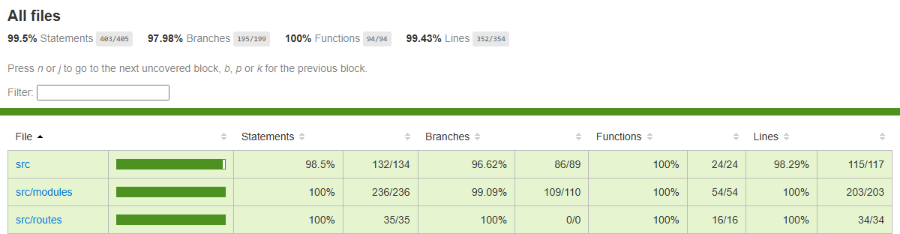

# Team 39 Assignment 4

Megan A Cowan (Darkgirl2442), Charles Mccallum (Muuurbles), Pete Sankar (mcisaura), Tommy Truong (tommy-truo)

## 1. GitHub Repository Link
https://github.com/tommy-truo/queue-smart

- The database code is in `backend/src/db.ts`. The modules in `backend/src/modules/` read and write it.
- Unit tests are in `backend/tests/`.
- Run the tests with `npm test` and the coverage report with `npm run coverage` from `backend/`.
- 111 tests pass, with about 99% line coverage.

## 2. Database Schema

We used **SQLite** through Node's built-in `node:sqlite` module. Foreign keys are turned on with `PRAGMA foreign_keys = ON`. Passwords are hashed with scrypt before they are saved in `UserCredentials.passwordHash`.

| Table           | Primary key    | Foreign keys                                 |
| --------------- | -------------- | -------------------------------------------- |
| UserCredentials | userId         | none                                         |
| UserProfile     | userId         | userId → UserCredentials                     |
| Service         | serviceId      | none                                         |
| Queue           | queueId        | serviceId → Service                          |
| QueueEntry      | entryId        | queueId → Queue, userId → UserCredentials    |
| Notification    | notificationId | userId → UserCredentials                     |
| History         | historyId      | userId → UserCredentials                     |

```sql
CREATE TABLE IF NOT EXISTS UserCredentials (
  userId       TEXT PRIMARY KEY,
  email        TEXT NOT NULL UNIQUE CHECK (length(email) <= 254),
  passwordHash TEXT NOT NULL,
  role         TEXT NOT NULL CHECK (role IN ('user', 'admin', 'employee'))
);

CREATE TABLE IF NOT EXISTS UserProfile (
  userId   TEXT PRIMARY KEY REFERENCES UserCredentials(userId) ON DELETE CASCADE,
  fullName TEXT NOT NULL CHECK (length(fullName) BETWEEN 1 AND 50),
  email    TEXT NOT NULL UNIQUE CHECK (length(email) <= 254),
  phone    TEXT CHECK (phone IS NULL OR length(phone) BETWEEN 10 AND 17)
);

CREATE TABLE IF NOT EXISTS Service (
  serviceId        TEXT PRIMARY KEY,
  name             TEXT NOT NULL UNIQUE CHECK (length(name) BETWEEN 1 AND 100),
  description      TEXT NOT NULL CHECK (length(description) <= 500),
  expectedDuration INTEGER NOT NULL CHECK (expectedDuration BETWEEN 1 AND 480),
  priority         TEXT NOT NULL CHECK (priority IN ('low', 'medium', 'high')),
  notification     TEXT CHECK (notification IS NULL OR length(notification) <= 500)
);

-- One queue per service. A closed queue stops new people from joining.
CREATE TABLE IF NOT EXISTS Queue (
  queueId   TEXT PRIMARY KEY,
  serviceId TEXT NOT NULL UNIQUE REFERENCES Service(serviceId) ON DELETE CASCADE,
  status    TEXT NOT NULL CHECK (status IN ('open', 'closed')),
  createdAt TEXT NOT NULL
);

CREATE TABLE IF NOT EXISTS QueueEntry (
  entryId     TEXT PRIMARY KEY,
  queueId     TEXT NOT NULL REFERENCES Queue(queueId) ON DELETE CASCADE,
  userId      TEXT NOT NULL REFERENCES UserCredentials(userId) ON DELETE CASCADE,
  position    INTEGER NOT NULL CHECK (position > 0),
  priority    TEXT NOT NULL CHECK (priority IN ('low', 'medium', 'high')),
  joinedAt    TEXT NOT NULL,
  calledAt    TEXT,
  almostReady INTEGER NOT NULL DEFAULT 0 CHECK (almostReady IN (0, 1)),
  status      TEXT NOT NULL CHECK (status IN ('waiting', 'served', 'canceled'))
);

-- A user can only be waiting once in the same queue.
CREATE UNIQUE INDEX IF NOT EXISTS OneActiveEntry ON QueueEntry (queueId, userId) WHERE status = 'waiting';

CREATE TABLE IF NOT EXISTS Notification (
  notificationId TEXT PRIMARY KEY,
  userId         TEXT NOT NULL REFERENCES UserCredentials(userId) ON DELETE CASCADE,
  type           TEXT NOT NULL CHECK (type IN ('queue-update', 'status-change')),
  message        TEXT NOT NULL CHECK (length(message) <= 1000),
  createdAt      TEXT NOT NULL,
  status         TEXT NOT NULL CHECK (status IN ('sent', 'viewed'))
);

CREATE TABLE IF NOT EXISTS History (
  historyId   TEXT PRIMARY KEY,
  userId      TEXT NOT NULL REFERENCES UserCredentials(userId) ON DELETE CASCADE,
  serviceName TEXT NOT NULL,
  occurredOn  TEXT NOT NULL,
  outcome     TEXT NOT NULL CHECK (outcome IN ('served', 'left', 'removed'))
);
```

## 3. Code Coverage Report

All 111 tests in 8 files pass. Output of `npm run coverage` (Vitest with v8):

| Metric     | Covered   | Percent |
| ---------- | --------- | ------- |
| Statements | 403 / 405 | 99.5%   |
| Branches   | 195 / 199 | 97.98%  |
| Functions  | 94 / 94   | 100%    |
| Lines      | 352 / 354 | 99.43%  |



## 4. Team Contribution Record

### Megan A Cowan


| Contribution               | Discussion notes                                                                 |
| -------------------------- | -------------------------------------------------------------------------------- |
| UserProfile email          | Added the email column to the UserProfile table and its seed data               |
| Registration               | Registration now saves the user's email in UserProfile too                      |
| Phone number               | Added a phone number field to registration, with length and format checks, saved in UserProfile, and tests |


### Charles Mccallum


| Contribution               | Discussion notes                                                                 |
| -------------------------- | -------------------------------------------------------------------------------- |
| Database schema            | SQLite tables for users, profiles, services, queues and queue entries, with keys, length limits and unique and check constraints |
| Password hashing           | Passwords are hashed with scrypt; login and registration use the database        |
| Services and queues        | Moved services, queues and queue entries from memory into SQLite                 |
| Seed data                  | Demo history, notifications and phone numbers for more users                     |
| Phone fixes                | Made phone optional on the registration form, sent it to the API and returned it on login |
| Styling                    | Restyled the header, cards, tables, buttons, forms and auth screens              |
| Unit tests                 | Tests for the schema, password hashing and each move to the database             |


### Tommy Truong


| Contribution               | Discussion notes                                                                 |
| -------------------------- | -------------------------------------------------------------------------------- |
| History table              | Added the History table, a notification type column and a 1–480 minute check on service duration |
| Notifications              | Moved notifications into SQLite, with unread/read stored as sent/viewed          |
| History                    | Moved queue history into SQLite and removed the in-memory list                   |
| README                     | Updated the README to describe the SQLite store                                  |
